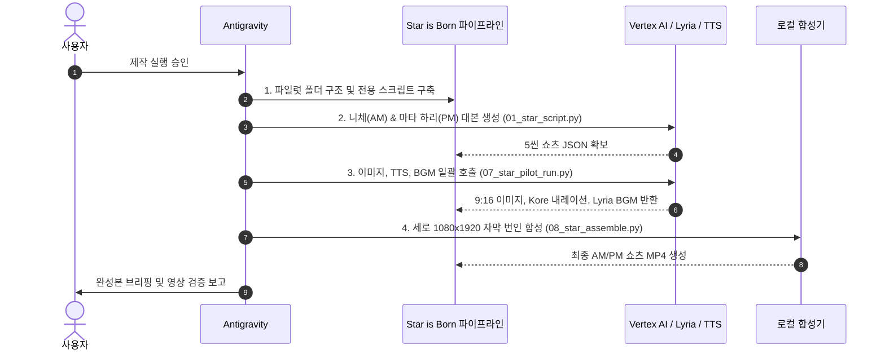

# [제작 실행 계획서] PRJ_standard 기반 '스타이즈본 (Star is Born)' 제작 파이프라인

> **참조 레퍼런스**: [`PRJ_standard`](file:///g:/%EB%82%B4%20%EB%93%9C%EB%9D%BC%EC%9D%B4%EB%B8%8C/2_%ED%94%84%EB%A1%9C%EC%A0%9D%ED%8A%B8/PRJ_starisborn/PRJ_standard) (Vertex AI + FFmpeg 표준 파이프라인)  
> **핵심 목표**: `PRJ_standard`의 모듈(`01_script`~`08_assemble`)을 9:16 세로형 쇼츠 및 AM/PM 듀얼 콘셉트에 맞게 최적화 개조하여 실제 제작에 즉시 착수할 수 있는 실행 체계를 완성한다.

---

## 1. 아키텍처 개요 및 PRJ_standard 연계 방향

기존 `PRJ_standard`는 16:9 가로형 다큐멘터리 제작에 맞춰져 있으므로, 이를 **9:16 세로형 쇼츠(Shorts)와 유쾌한 인물 스토리텔링 포맷**으로 확장·특화합니다.

```mermaid
flowchart TD
    subgraph PRJ_standard_Assets [PRJ_standard 핵심 자산 계승]
        CRED[application_default_credentials.json<br>GCP Vertex AI 인증]
        FONT[GmarketSansTTFBold.ttf<br>한글 볼드 폰트]
    end

    subgraph StarIsBorn_Pipeline [Star is Born 파이프라인 개조]
        CAL[data/calendar_db.json<br>365일 AM/PM 인물 DB] --> SCRIPT[01_star_script.py<br>Gemini-2.5-Pro<br>AM 탄생 / PM 작별 모드]
        SCRIPT --> RUN[07_star_pilot_run.py<br>일괄 에셋 생성 오케스트레이터]
        
        RUN --> IMG[02_star_image.py<br>Gemini Nano Banana / Flash<br>9:16 팝아트/캐리커처]
        RUN --> TTS[03_star_tts.py<br>Gemini TTS Kore<br>스피디한 딕션 음성]
        RUN --> BGM[05_star_music.py<br>Lyria-002<br>AM:펑키 / PM:시네마틱 로파이]
        
        IMG --> VEO[04_star_video.py<br>Veo 3.1 Fast (선택)<br>오프닝 4초 9:16 클립]
        
        VEO --> ASS[08_star_assemble.py<br>FFmpeg 9:16 세로 합성<br>Ken Burns + 중앙 볼드 자막]
        IMG --> ASS
        TTS --> ASS
        BGM --> ASS
    end

    CRED --> SCRIPT
    CRED --> IMG
    CRED --> TTS
    CRED --> BGM
    CRED --> VEO
    FONT --> ASS
    ASS --> OUT([최종 55초 쇼츠 MP4<br>AM/PM 일일 2편 완성])
```

---

## 2. 모듈별 세부 개조 사양 (PRJ_standard → Star is Born)

| # | 원본 모듈 (`PRJ_standard/config/`) | 개조 모듈 (`src/` 또는 `config/`) | 개조 사양 및 프롬프트 최적화 |
|---|---|---|---|
| **01** | `01_script.py` | `01_star_script.py` | • `--mode am`(탄생) / `--mode pm`(사망) 파라미터 추가<br>• 쇼츠 규격(5씬, 총 50~55초 분량) 고정<br>• **Google Search Grounding + Fact Checklist 검증 루프 탑재**<br>• 톤앤매너 프롬프트: **"위인전 어투 절대 금지, 찰진 구어체, 풍자와 유머, 검증된 기행/반전 발굴"** 주입 |
| **02** | `02_image.py` | `02_star_image.py` | • 해상도 규격을 **9:16 세로형**(`vertical 9:16`)으로 프롬프트 변경<br>• 비주얼 스타일: `hyper-realistic retro pop-art caricature, vivid cinematic lighting, dynamic expression, 9:16 vertical poster style, no text` |
| **03** | `03_tts.py` | `03_star_tts.py` | • 기존 `Kore`(여성) 보이스 유지하되, 대본 문장 부호(쉼표, 느낌표) 최적화로 빠른 템포와 위트 있는 리듬감 부여 |
| **04** | `04_video.py` | `04_star_video.py` | • Veo 3.1 Fast의 종횡비를 `9:16` 세로 모드로 설정<br>• 비용 절감을 위해 **1편당 씬 1(오프닝 3~4초 훅)**에만 선별 적용 |
| **05** | `05_music.py` | `05_star_music.py` | • **AM 모드**: `Upbeat quirky funk jazz with bouncy bass, lively and energetic, 30s`<br>• **PM 모드**: `Cinematic mellow lo-fi hip-hop with warm electric piano and vinyl crackle, nostalgic, 30s` |
| **06** | `06_subtitle.py` | `06_star_subtitle.py` | • 쇼츠 전용 어그로 썸네일 문구(15자 내외) + 유튜브 태그/해시태그 자동 추출 |
| **07** | `07_pilot_run.py` | `07_star_pilot_run.py` | • 대본 JSON을 읽어 이미지(5장) + TTS(5개) + BGM(1곡) 병렬 생성 관리 |
| **08** | `08_assemble.py` | `08_star_assemble.py` | • 가로 1920x1080 ➔ **세로 1080x1920 (9:16)** 전환<br>• 정지 이미지에 **Ken Burns 효과(천천히 줌인/줌아웃)** 적용하여 정적 느낌 제거<br>• 자막 스타일: 하단 여백(`MarginV=250`), 볼드 폰트 크기 `FontSize=24`, 노란색 강조 스타일 번인 |

---

## 2.1 [핵심] 원천 소스(Source) 및 3단계 팩트체크(Fact-Check) 검증 시스템

역사/인물 콘텐츠는 유쾌한 재미도 중요하지만, **"날짜(생일/기일), 연도, 실존 사건, 사망 원인"이 틀리는 순간 채널의 신뢰도가 즉시 추락**합니다.  
기존 `PRJ_standard`의 `01_script.py`는 LLM 자체 파라미터 지식에만 의존해 할루시네이션(거짓 팩트 생성) 위험이 있었습니다.  
이를 극복하기 위해 **원천 소스 티어링과 3단계 기술적 팩트체크 가드레일**을 구축합니다.

### 1) 정보 출처의 신뢰성 계층화 (Source Tiering)
* **Tier 1 (기초 팩트 및 날짜 검증 - 100% 필수)**:
  - **위키데이터(Wikidata)**: 전 세계 인물의 탄생일(P569), 사망일(P570), 직업, 국적 등 정형 데이터 크로스체크
  - **브리태니커 백과사전(Encyclopaedia Britannica)** & **On This Day 공식 역사 아카이브**
  - *규칙: 위키데이터와 브리태니커 기준 날짜가 일치하지 않는 인물은 콘텐츠 후보에서 제외.*
* **Tier 2 (공식 전기 및 역사적 사실)**:
  - 인물의 공식 자서전(Autobiography), 공식 전기(Biography), 공신력 있는 언론(NYT, BBC, 로이터 등) 부고(Obituary) 기사
* **Tier 3 (기행, 사생활, 비하인드 썰)**:
  - 인물의 서한집(Letters), 일기, 동시대인의 회고록
  - *규칙: 정설이 아닌 야사나 루머는 "정설로 확인된 바는 없으나 당시 세간에는 ~라는 소문이 돌았습니다"와 같이 안전 워딩 처리.*

### 2) 기술적 3단계 팩트체크 파이프라인 (01_star_script.py 내 통합)

```mermaid
flowchart TD
    A[인물명 및 날짜 입력] --> B[Step 1. Google Search Grounding<br>Vertex AI 실시간 검색 연동]
    B --> C[Step 2. 팩트 검증 체크리스트 JSON 추출<br>날짜/연도/핵심사건/루머판별]
    C --> D{팩트 부합 여부 판정}
    D -- 불일치/할루시네이션 --o E[소재 교체 또는 팩트 수정]
    D -- 100% 검증 완료 --o F[Step 3. 검증된 팩트 기반 대본 생성<br>가드레일 프롬프트 적용]
    F --> G[유튜브 설명란 출처(References) 자동 생성]
```

1. **Step 1: Google Search Grounding (실시간 웹 그라운딩)**
   - `gemini-2.5-pro` 호출 시 Vertex AI의 `tools=[types.Tool(google_search=types.GoogleSearch())]`를 강제 활성화.
   - LLM이 자체 상상으로 말하지 못하도록, 실시간 구글 검색을 통해 해당 날짜(M월 D일)의 탄생/사망 여부와 에피소드 실존 여부를 실제 웹 출처 URL과 함께 확인.
2. **Step 2: Fact Verification Checklist (팩트 검증 JSON 선행 생성)**
   - 대본을 쓰기 전, 아래와 같은 구조의 팩트 검증 시트를 먼저 생성하여 검증 통과 여부를 체크:
     ```json
     {
       "person_name": "프리드리히 니체",
       "target_date": "10-15",
       "event_type": "BORN",
       "verified_year": 1844,
       "primary_sources": ["Britannica", "Wikidata Q9358"],
       "verified_claims": [
         {"claim": "목사의 아들로 태어남", "is_verified": true},
         {"claim": "토리노 광장에서 마부에게 맞던 말을 껴안고 오열 후 쓰러짐", "is_verified": true, "note": "1889년 1월 토리노 일화 확인"},
         {"claim": "거대한 콧수염 때문에 국물 요리를 먹기 힘들었다는 불평", "is_verified": true, "note": "서한집 기록"}
       ],
       "unverified_or_myths": [
         {"myth": "니체는 생전에 나치주의자였다", "truth": "사후 여동생의 왜곡 편집으로 밝혀짐 - 대본 서술 시 주의 요망"}
       ]
     }
     ```
3. **Step 3: Verification Guardrail (안전 가드레일 대본화)**
   - 검증된 `verified_claims`만을 대본의 재료로 사용.
   - `unverified_or_myths`는 배제하거나, "사실 많은 사람들이 오해하지만~"과 같은 반전 팩트 킬러 콘텐츠로 승화.

### 3) 365일 마스터 캘린더 DB 사전 정제
- 매일 임의로 검색하는 것이 아니라, 사전에 365일치(AM 365명, PM 365명 총 730명)를 위키데이터 ID 및 브리태니커 링크와 함께 검증 정제한 `data/calendar_db.json`을 단계적으로 구축.
- 날짜 오류 가능성을 0%로 통제.

### 4) 시청자 신뢰를 위한 설명란 투명 출처 표기
- 영상 더보기란 및 고정 댓글에 `[Fact Check & References]` 섹션을 자동 삽입:
  *(예: "본 영상은 브리태니커 백과사전, 위키데이터(Q9358), 니체의 서한집 기록을 바탕으로 교차 검증 후 제작되었습니다.")*
- 시청자에게 학술적 신뢰감과 힙한 재미를 동시에 전달.

---

## 3. 오늘자 (10월 15일) 파일럿 1호 제작 사양서

오늘 날짜(10월 15일)에 실제로 태어나고 사망한 레전드 스타를 매칭하여 즉시 테스트 제작에 투입합니다.

### 3.1 [AM 07:30] 오늘 태어난 스타: 프리드리히 니체 (Friedrich Nietzsche)
- **생년월일**: 1844년 10월 15일생
- **장르**: 철학 / 사상 (괴짜 천재)
- **콘텐츠 타이틀**: *"신은 죽었다더니 말 안고 통곡한 콧수염 괴짜의 탄생 #shorts"*
- **핵심 썰**:
  1. 어릴 때 별명이 '꼬마 목사'였을 정도로 범생이였으나 훗날 "신은 죽었다"로 세계관을 박살냄.
  2. 트레이드마크인 거대한 바다코끼리 콧수염은 사실 국을 먹을 때 국물이 다 묻는 애물단지였음.
  3. 이탈리아 토리노 광장에서 마부에게 채찍질당하는 말을 보고 눈물을 흘리며 말을 끌어안고 쓰러진 유명한 일화.

### 3.2 [PM 18:30] 오늘 사망한 스타: 마타 하리 (Mata Hari)
- **기일**: 1917년 10월 15일 총살형 사망
- **장르**: 무용 / 역사 (세기의 스파이)
- **콘텐츠 타이틀**: *"총살 집행관들에게 손키스를 날리고 떠난 세기의 스파이 #shorts"*
- **핵심 썰**:
  1. 네덜란드 출신의 평범한 여성이 자바 섬의 신비로운 무희로 둔갑해 유럽 상류층을 홀린 사기급 매력.
  2. 1차 세계대전 당시 프랑스와 독일을 넘나들며 이중 스파이 혐의로 체포.
  3. 사형장 총살대 앞에서도 눈가리개를 거부하고, 12명의 사형 집행 군인들에게 당당하게 손키스를 날린 전설의 마지막 순간.

---

## 4. 구체적 단계별 실행 계획 (Action Plan)



### 단계별 태스크:

* **Step 1: 작업 환경 및 모듈 세팅**
  - `PRJ_starisborn/src/` 디렉토리 생성
  - `PRJ_standard/config/application_default_credentials.json` 심볼릭 링크 또는 경로 참조 유지
  - 세로형 쇼츠용 템플릿 코드 구현 (`01_star_script.py`, `08_star_assemble.py` 등)

* **Step 2: 파일럿 대본 생성 (AM 니체 / PM 마타 하리)**
  - Vertex AI `gemini-2.5-pro` 호출
  - JSON 대본 생성: 5씬 구성, 각 씬 10초 내외, 구어체 나레이션, 9:16 비주얼 프롬프트

* **Step 3: 에셋 생성 (Image + TTS + Music)**
  - `02_star_image.py`: 씬별 9:16 일러스트 생성 (총 5장 x 2편)
  - `03_star_tts.py`: Gemini Kore 음성 생성 (24kHz WAV)
  - `05_star_music.py`: AM 펑키 재즈 1곡, PM 감성 힙합 1곡 생성

* **Step 4: 세로형 비디오 조립 (FFmpeg)**
  - 1080x1920 세로 렌더링
  - Ken Burns 줌 효과 적용
  - 자막 번인 (하단 가독성 최적화)
  - 최종본: `output/pilot_am_nietzsche.mp4`, `output/pilot_pm_matahari.mp4`

---

## 5. 예상 소요 비용 및 리소스 (1일 2편 기준)

| 항목 | 사용 모델 | 단가 기준 | 1편 소요 비용 | 1일(2편) 비용 |
|---|---|---|---|---|
| **대본/자막** | Gemini-2.5-Pro / Flash | 토큰 과금 | ~$0.005 | ~$0.01 |
| **이미지 (5장)** | Gemini Nano Banana 2.1 | 건당 과금 | ~$0.02 | ~$0.04 |
| **TTS (5개)** | Gemini 2.5 Flash TTS (Kore) | 문자수 과금 | ~$0.005 | ~$0.01 |
| **BGM (1곡)** | Lyria-002 (30초) | 곡당 과금 | SKU 확인 (수 센트) | ~$0.05 |
| **Veo 영상 (선택)** | Veo 3.1 Fast (4초 1개) | $0.10/초 | $0.40 (적용 시) | $0.80 |
| **합계 (기본형)** | **이미지 + TTS + BGM** | — | **약 $0.08 (100원 내외)** | **약 $0.16 (200원)** |
| **합계 (고급형)** | **Veo 4초 오프닝 포함** | — | **약 $0.48 (650원)** | **약 $0.96 (1,300원)** |

---

## 6. 승인 및 착수 요청

본 계획서는 `PRJ_standard`의 기존 인증 및 코드를 100% 재사용하여 리스크 없이 즉시 가동 가능하도록 설계되었습니다.
사용자님의 확인 후, **Step 1(환경 세팅) 및 Step 2(오늘자 니체/마타 하리 대본 및 에셋 생성)**를 즉시 실행하겠습니다.
